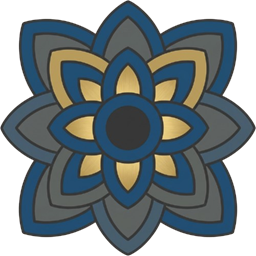

<!--
# SPDX-FileCopyrightText: Copyright 2026 Dalia Emulator Project
# SPDX-License-Identifier: GPL-3.0-or-later
-->

<p align="center">
  
</p>

<h1 align="center">Dalia</h1>

<p align="center">
  <strong>Emulador experimental y de código abierto para Nintendo Switch y Switch 2 escrito en C++.</strong>
</p>

<p align="center">
  <a href="https://github.com/azeselh/Eglantine_Aze/releases"></a>
  <a href="LICENSE.txt"></a>
  
  
</p>

---

## 🌸 Acerca de Dalia

**Dalia** es un emulador experimental desarrollado en C++20 con foco en la precisión visual, el rendimiento optimizado y la compatibilidad con títulos de Nintendo Switch y Switch 2.

Este proyecto se basa y continúa el trabajo de destacados emuladores de la comunidad de código abierto —incluyendo Eglantine, Eden, yuzu y Sudachi—, incorporando correcciones avanzadas en el renderizador, optimizaciones en el manejo de texturas y memoria, y sincronizaciones específicas para maximizar la estabilidad gráfica y la tasa de cuadros.

> [!NOTE]
> Dalia es un proyecto independiente de código abierto y no está afiliado, respaldado ni patrocinado por Nintendo. Para utilizar el emulador es necesario contar con volcados legales de tus propios juegos, claves criptográficas (`prod.keys`) y firmware.

---

## 🚀 Características principales

- **Renderizador Vulkan de alto rendimiento:** Pipeline gráfico optimizado con soporte para transcodificación ASTC por lotes, cache de pipelines de bajo retraso, corrección precisa de layouts Maxwell/GOB en subrecursos y texturas 2D, y sincronización adaptativa de ticks GPU.
- **Compatibilidad con arquitectura Switch 2:** Soporte para instrucciones Ampere y macros Turing en el re-compilador de shaders, tiling nativo por bloques y soporte para llamadas de cómputo nativo.
- **Emulación de CPU con Dynarmic:** Re-compilación dinámica JIT de 64 bits (A64) con soporte de reloj atómico sincronizado y optimizaciones de giro/polling en bucles de espera.
- **Arquitectura GPU Split multihilo:** Separación del procesamiento frontal y trasero de comandos de GPU para eliminar cuellos de botella en la CPU y mejorar el frame pacing.
- **Interfaz moderna en Qt6:** Interfaz gráfica limpia e intuitiva, gestión visual de biblioteca de juegos, configuración granular por título, soporte para mods (LayeredFS) y actualización de contenido.
- **Audio Core & HLE robusto:** Emulación de servicios del sistema operativo de bajo impacto y reproducción de audio de latencia ultrabaja.

---

## 📦 Descarga y uso

### Descargas
Puedes descargar las versiones compiladas más recientes directamente desde la sección de **[Releases](https://github.com/azeselh/Eglantine_Aze/releases)** del repositorio.

En Windows, extrae el archivo en una carpeta y ejecuta:
- **`dalia.exe`**: Interfaz gráfica de usuario (GUI).
- **`dalia-cli.exe`**: Interfaz de línea de comandos para automatización y depuración.

### Directorios de datos y perfiles

Dalia almacena configuraciones, estados guardados y shaders en su propio directorio:

- **Windows:** `%APPDATA%\dalia`
- **Linux:** `~/.local/share/dalia`, `~/.config/dalia`, `~/.cache/dalia`
- **Modo portátil:** Crea una carpeta llamada `user` en el mismo directorio donde se encuentra `dalia.exe`. Dalia utilizará automáticamente esa carpeta para todos sus datos sin tocar el sistema.

### Migración de datos
En su primer inicio no portátil, Dalia permite importar automáticamente configuraciones y partidas guardadas desde perfiles previos detectados (`%APPDATA%\eden`, `%APPDATA%\lichii`, `%APPDATA%\yuzu`), manteniendo copias de respaldo de tus partidas intactas.

---

## 🛠️ Compilación desde el código fuente

### Requisitos previos

- **CMake:** Versión 3.31 o superior.
- **Compilador C++20:**
  - Windows: Visual Studio 2022 (MSVC v143+) o Clang-cl (LLVM 18+).
  - Linux: GCC 13+ o Clang 18+.
- **Generador:** Ninja (recomendado).
- **Librerías externas:** Qt 6 (Widgets, Core, Gui), Vulkan SDK 1.3+.

### Instrucciones de compilación (Windows / Linux)

```bash
# 1. Clonar el repositorio
git clone https://github.com/azeselh/Eglantine_Aze.git
cd Eglantine_Aze

# 2. Configurar el proyecto con CMake
cmake -S . -B build -G Ninja -DCMAKE_BUILD_TYPE=Release

# 3. Compilar el emulador y la CLI
cmake --build build --target yuzu yuzu-cmd --parallel
```

Los ejecutables resultantes se ubicarán en `build/bin/`:
- `build/bin/dalia.exe` (o `dalia` en Linux)
- `build/bin/dalia-cli.exe` (o `dalia-cli` en Linux)

Para más detalles sobre dependencias de plataformas específicas, consulta la [Guía de compilación](docs/Build.md).

---

## 📋 Reporte de problemas

Si encuentras algún fallo técnico o incompatibilidad gráfica:

1. Comprueba si el problema ya ha sido reportado en la sección de **[Issues](https://github.com/azeselh/Eglantine_Aze/issues)**.
2. Al abrir un nuevo reporte, incluye:
   - Especificaciones completas de hardware (CPU, GPU, versión del controlador gráfico, SO).
   - Título e ID del programa afectado.
   - Archivo de registro del emulador (`eden_log.txt` ubicado en `%APPDATA%\dalia\log\`).
   - Pasos claros para reproducir el comportamiento.

> [!CAUTION]
> Nunca compartas ni adjuntes volcados de juegos con derechos de autor, volcados de memoria que contengan claves privadas ni archivos `prod.keys` / firmware en los reportes de problemas.

---

## 📜 Licencia y agradecimientos

Dalia se distribuye bajo los términos de la **GNU General Public License v3.0 o posterior** ([GPL-3.0-or-later](LICENSE.txt)).

Dalia reconoce y agradece profundamente el trabajo de:
- **Eglantine Project** y **Camille LaVey**
- **Eden Emulator Project**
- **yuzu Emulator Project**
- **Sudachi Project**
- **Dynarmic Team**
- Todos los colaboradores de la comunidad de emulación de Nintendo Switch.
